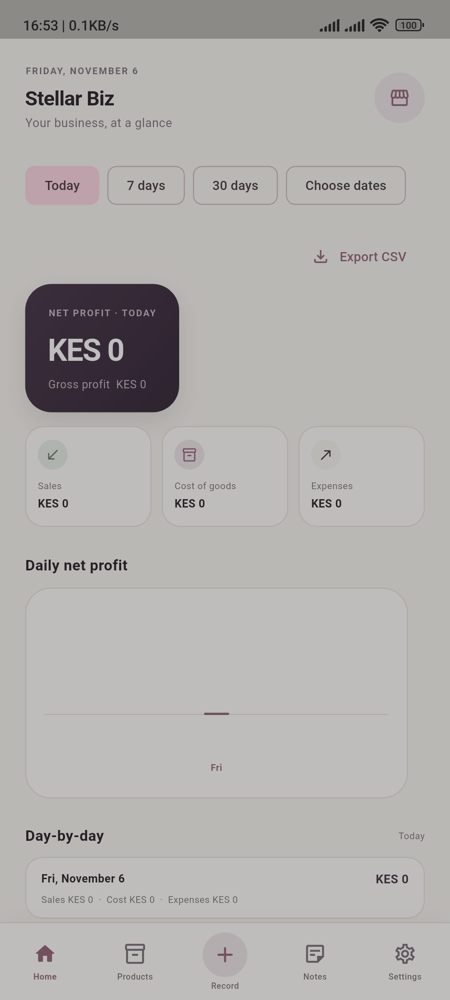
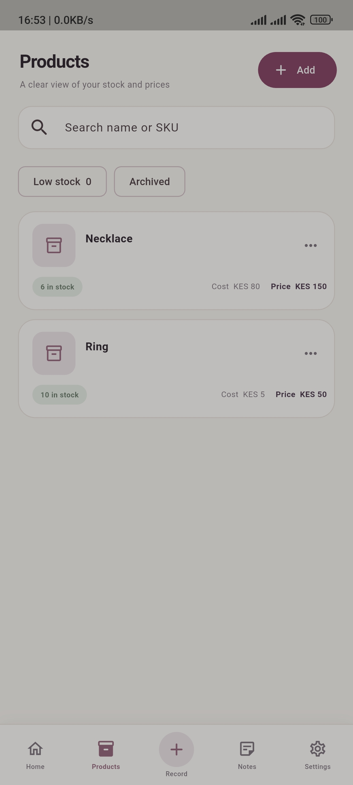
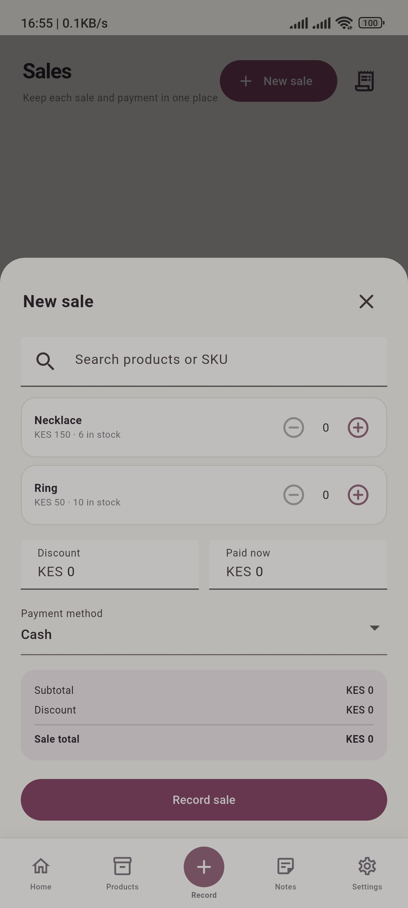
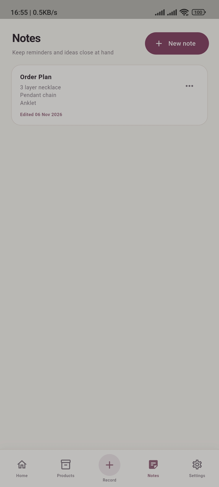
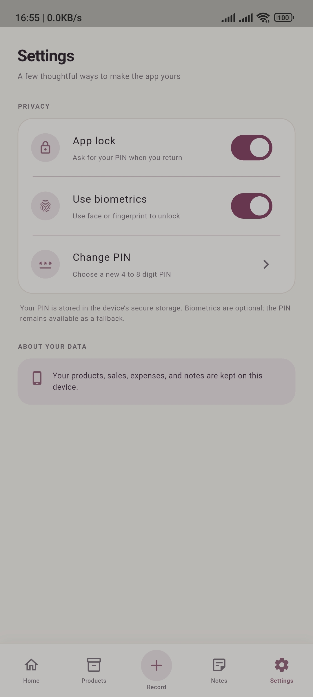

# Stellar Biz — Version 1

Stellar Biz is a simple, local-first inventory and accounting app for independent sellers. It helps a sole proprietor keep products, stock, sales, expenses, notes, and day-to-day profit in one place.

**Version:** `1.0.0+1` · **Currency:** KES · **Storage:** On device; no account or internet connection is required for normal use.

## Screenshots

<details>
<summary>View the app screens</summary>

These device captures show the main v1 screens. The primary create actions have since been moved to the bottom of their screens, above the navigation bar.

| Dashboard | Products |
| --- | --- |
|  |  |

| Record a sale | Notes |
| --- | --- |
|  |  |

| Settings |
| --- |
|  |

</details>

## What’s included

- **Dashboard:** See daily sales, cost of goods, expenses, gross profit, and net profit. View today, the last 7 or 30 days, or choose a custom period. Export a profit report as CSV and see low-stock alerts.
- **Products and inventory:** Add, edit, archive, and remove products; attach a photo from the device or camera; track stock, adjust quantities, and review stock history.
- **Sales and payments:** Search products by name or SKU, add sale quantities, record a discount and payment method, and record later payments. Recording a sale updates stock.
- **Expenses:** Record and review business expenses; void an expense while keeping its record.
- **Notes:** Keep and edit personal business notes on the device.
- **Optional app lock:** Protect access with a 4–8 digit PIN and, where available, biometric unlock.
- **Mobile-friendly interface:** Five-tab navigation, a warm cream, rose, sage, and plum theme, and create actions placed near the bottom of the main screens.

## Profit calculation

The dashboard derives profit from recorded transactions: gross profit is sales revenue less cost of goods sold; net profit is gross profit less active operating expenses. Figures are a management estimate based on the information entered in the app. Stellar Biz does not prepare statutory accounts or calculate tax.

## Data and v1 scope

Stellar Biz stores business records in a local SQLite database. Product photos are resized before being saved in app storage. There is no cloud account or sync in v1. The optional PIN is stored using platform secure storage; biometrics use the device’s authentication system.

Built-in backup and restore, multi-user access, barcode scanning, supplier management, and tax features are outside v1. Keep a separate copy of important business records.

## Run locally

Install Flutter with the Dart SDK version required by [`pubspec.yaml`](pubspec.yaml), then run:

```sh
flutter pub get
flutter run
```

## Tech stack

- Flutter and Dart
- Riverpod for application state
- `go_router` for navigation
- Drift and SQLite for local persistence
- `local_auth` and `flutter_secure_storage` for optional app locking
- `image_picker` for product photos
- `share_plus` for sharing CSV reports

## Project structure

```text
lib/
├── app/                 # App setup, routing, and theme
├── core/                # Shared database, security, errors, and utilities
├── features/
│   ├── dashboard/
│   ├── products/
│   ├── sales/
│   ├── expenses/
│   ├── inventory/
│   ├── reports/
│   ├── notes/
│   └── settings/
└── main.dart
```

Feature code is organized into `data/`, `domain/`, and `presentation/`; shared concerns live under `core/`.

## License

This project is licensed under the MIT License. See [LICENSE](LICENSE).
